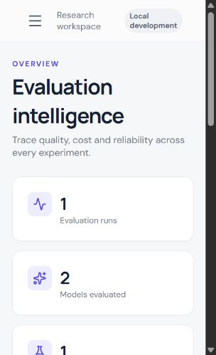
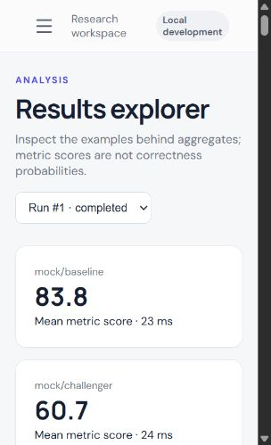
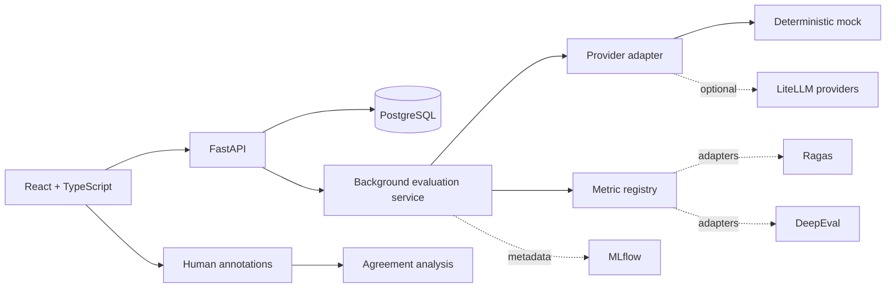

# EvalAI — LLM Evaluation & Benchmarking Platform

EvalAI is a mock-first, research-oriented application for comparing model quality, latency, token usage, estimated cost, response consistency, and evaluator–human agreement. It deliberately treats automated evaluators as measurements—not ground truth.

## Quick start

### Docker (PostgreSQL)

```bash
docker compose up --build
```

Open `http://localhost:5173`; API documentation is at `http://localhost:8000/docs`. Results produced in the default configuration are prominently labelled **mock / synthetic**.

### Local development

```bash
python -m pip install -r backend/requirements.txt
cd backend && uvicorn app.main:app --reload
cd frontend && pnpm install && pnpm dev
```

SQLite is the zero-configuration local default. Docker and production use PostgreSQL through `DATABASE_URL`. Copy `.env.example` to `.env` only for local configuration; never commit secrets.

## Reproducible workflow

1. Create a versioned dataset in **Datasets** or import `evaluation/datasets/synthetic_qa.jsonl` through the API.
2. Choose a frozen dataset version, models, metrics, and repetitions in **Configure**.
3. Launch the job from **Runner**. The request returns immediately; progress is persisted.
4. Inspect each response and metric in **Results**.
5. Label responses in **Human review**, then calculate agreement in **Reports**.
6. Export CSV/JSON records, including errors and estimated-usage flags.

## Verified application screenshots

These images were captured from the locally running production build populated by the executed mock experiment described in `outputs/example-experiment-report.md`.





For a scripted baseline, start the API and run `python evaluation/scripts/run_mock_experiment.py` from the repository root.

## Architecture



The current executable baseline includes deterministic lexical metrics and a mock provider. Ragas, DeepEval, live LiteLLM providers, and remote MLflow are extension boundaries: they require evaluator/provider credentials and are not silently substituted for the deterministic local behavior.

## Metric contract

| Metric | Required input | Interpretation | Important limitation |
|---|---|---|---|
| Exact match | reference | normalized equality, 0 or 1 | rejects correct paraphrases |
| Token F1 | reference | lexical overlap, 0–1 | overlap is not factual correctness |
| Relevance | prompt | prompt/answer vocabulary coverage | topical text may be wrong |
| Faithfulness | context | lexical support in supplied context | not semantic entailment; context may be wrong |
| Consistency | repeated outputs | similarity to the first generation | stable answers can be consistently false |

Scores are never presented as calibrated probabilities. Unsupported combinations are rejected before execution or stored with a skip reason.

## Research methodology

### Experiment A — evaluator agreement

Blind a representative, stratified sample where practical. Use a written correctness rubric, preserve reviewer identity and rationale, and keep annotations separate from automated results. Threshold an automated score only when the classification task is defined in advance. Report confusion matrix, accuracy, precision, recall, F1, Cohen's kappa, sample size, and missing labels. Kappa is only meaningful for compatible categorical labels; Spearman correlation is appropriate for paired ordinal scores, not binary-only data.

### Experiment B — model comparison

Freeze dataset version, prompt, temperature, repetition count, and evaluation versions. Record missing calls and provider errors. Compare per-task quality together with latency and cost—never silently drop failures.

### Experiment C — consistency

Generate repeated answers under documented settings and compare similarity distributions plus qualitative examples. Similarity describes stability, not truth.

## Dataset and annotation guidelines

- Stable `example_id` values must remain unchanged within a version.
- Reference answers are optional unless a selected metric requires them.
- Context should contain the evidence an annotator is expected to use.
- Split rubric design, pilot annotation, and final annotation; measure inter-reviewer agreement before adjudication.
- Do not use `synthetic_qa.jsonl` as research evidence. It is only a deterministic development fixture.
- Avoid exposing model identity during review when practical, and randomize order for pairwise judgments.

## Testing

```bash
PYTHONPATH=backend pytest backend/tests -q
cd frontend && pnpm build
```

Tests cover versioning, invalid metric/data combinations, metric edge cases, deterministic end-to-end execution, persisted status transitions, human annotation, reliability analysis, and exports.

## Security and privacy

Secrets are environment variables. The application does not log API keys and mock mode sends no prompts to external providers. For multi-user or internet-facing deployment, add an identity provider and resource-scoped authorization before storing private datasets. Configure provider timeouts, organization-specific retention rules, encrypted backups, and a queue worker before production scale. Prompt content can be sensitive even when API keys are redacted.

## Known limitations

- The in-process background executor is suitable for local research, not distributed production; use Celery/Arq or a managed queue for durable workers.
- The executable baseline intentionally does not claim Ragas/DeepEval or LLM-judge results without credentials and explicit adapter configuration.
- Current cost values from the mock provider are estimates based on a documented fixture rate.
- Authentication is not enabled; this build is a single-workspace research baseline.
- Docker was not assumed available in the local runtime; CI verifies builds in an environment with Docker/Node/Python support.

